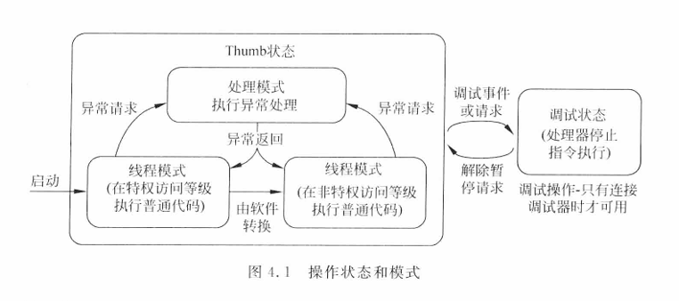
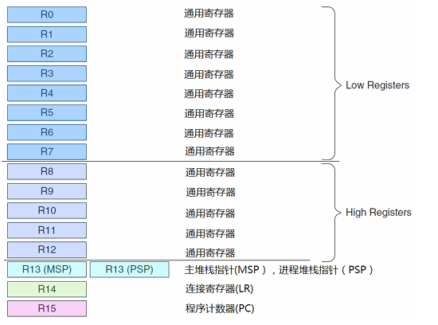
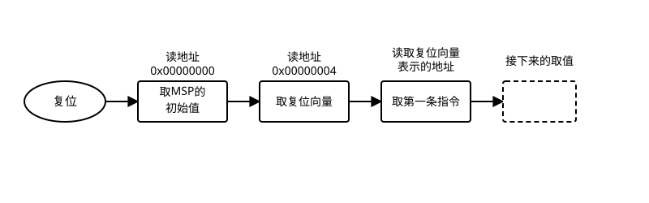
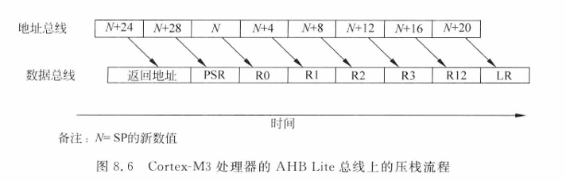
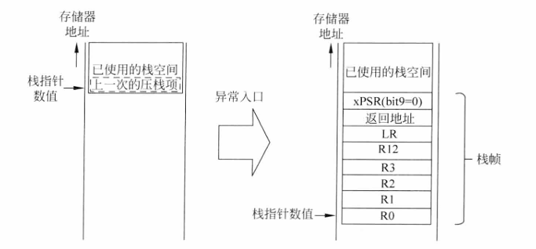
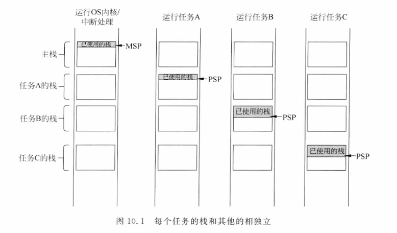
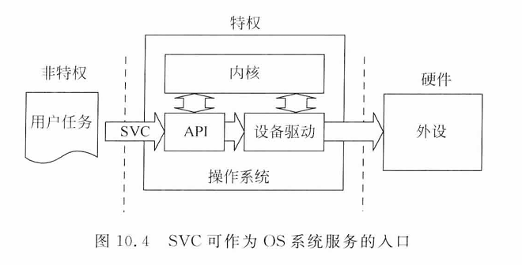
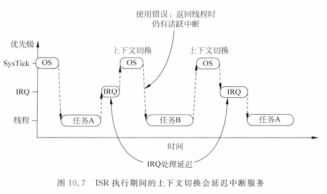
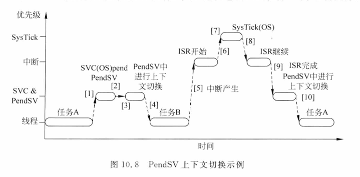

项目使用的开发硬件是 stm32 开发板，基于 ARM Cortex-M4 架构，首先来介绍一下该架构的基础知识，留个印象。

# 操作模式和特权等级

Cortex‐M3/4 支持两个操作模式和两个特权等级，两个操作模式是处理模式和线程模式，分别用于异常服务的代码和普通代码。

两个特权等级是特权级和用户级，在特权等级运行 OS 内核，用户等级运行应用任务，通过存储器保护单元（MPU）设置存储器访问权限，可以避免应用任务破坏 OS 内核和外设。



# 寄存器

## 通用寄存器



## 特殊寄存器

特殊寄存器不在存储器地址空间里，只能用 `MRS` / `MSR` 指令访问。

### 应用状态寄存器 xPSR

xPSR 是三个寄存器的合集：APSR（应用）、EPSR（执行）、IPSR（中断）

| 位域                   | 名称             | 描述                               |
| -------------------- | -------------- | -------------------------------- |
| N (31)               | 负标志            | 运算结果为负时置 1                       |
| Z (30)               | 零标志            | 运算结果为 0 时置 1                     |
| C (29)               | 进位/借位          | 进位或无符号减法不借位时为 1                  |
| V (28)               | 溢出标志           | 有符号运算溢出时置 1                      |
| Q (27)               | 饱和标志           | 饱和运算结果溢出时置 1                     |
| ICI/IT (26:25/15:10) | 中断继续 / IF-THEN | 用于恢复被中断的 IT 块或多周期指令              |
| T (24)               | Thumb 标志       | Cortex-M 必须为 1，置 0 触发 UsageFault |
| 异常编号 (8:0)           | 异常号            | 当前正在处理的异常编号，空闲时为 0               |

### 异常屏蔽寄存器

PRIMASK、FAULTMASK、BASEPRI 三个，只能在特权级下访问。

| 寄存器       | 宽度      | 描述                                |
| --------- | ------- | --------------------------------- |
| PRIMASK   | 1 bit   | 置 1 屏蔽所有可屏蔽中断（NMI 和 HardFault 除外） |
| FAULTMASK | 1 bit   | 比 PRIMASK 更强，连 HardFault 也屏蔽      |
| BASEPRI   | 3–4 bit | 屏蔽**相同或更低**优先级的中断，粒度比 PRIMASK 细   |

### CONTROL 寄存器

| 位域        | 功能                                           |
| --------- | -------------------------------------------- |
| [0] nPRIV | 0 = 特权级线程模式<br>1 = 非特权级（用户模式）<br>处理模式永远都是特权级 |
| [1] SPSEL | 0 = MSP（默认）<br>1 = PSP<br>在处理模式下， 只允许使用 MSP  |
| [2] FPCA  | 浮点上下文活跃标志（CM4F 才有）                           |

切换到用户线程时，就需要操作 CONTROL 寄存器，修改特权等级和 sp 指针的选择。


---

# STM32 的启动流程

众所周知，C 程序从 `main()` 开始，实际上 STM32 在进入 `main()` 之前已经干了不少活。

## 复位

芯片上电或者系统复位后，硬件从 `0x00000000` 开始，读 4 个字节作为 MSP 初始值，再读 4 个字节作为复位向量（PC 起点），也就是 Reset_Handler。



在 `startup_stm32l452xx.s` 中可以找到向量表定义：
```assembly
g_pfnVectors:
    .word   _estack
    .word   Reset_Handler
    .word   NMI_Handler
    .word   HardFault_Handler
    .word   MemManage_Handler
    .word   BusFault_Handler
    .word   UsageFault_Handler
    ...
```

在链接脚本 `STM32L452XX_FLASH.ld`，我们可以找到 `_estack` 的初始值，设置在了整个 RAM 的最顶部：

```ld
/* Highest address of the user mode stack */
_estack = ORIGIN(RAM) + LENGTH(RAM);    /* end of RAM */

MEMORY
{
RAM (xrw)      : ORIGIN = 0x20000000, LENGTH = 128K
RAM2 (xrw)      : ORIGIN = 0x10000000, LENGTH = 32K
FLASH (rx)      : ORIGIN = 0x8000000, LENGTH = 512K
}
```

STM32L452RE 的 RAM 是 128KB SRAM1 + 32KB SRAM2，`_estack` 指向 0x20020000。复位后 MSP 被初始化为这个值，作为栈顶，接着执行 Reset_Handler：

```assembly
Reset_Handler:
    ldr   sp, =_estack        ; 1. 重设栈指针（可以设置到外部存储器）
    bl    SystemInit          ; 2. 初始化时钟、配置向量表偏移
    ; 3. 搬运 .data 段从 Flash 到 SRAM
    ; 4. 清零 .bss 段
    bl    __libc_init_array   ; 5. 初始化 C 运行时
    bl    main                ; 6. 跳转到 main
```

# 异常和中断

Cortex-M 架构把中断也统一归为异常来管理。中断是异常的一种，外设触发；其他系统异常（HardFault、SVC、PendSV）由内核内部产生或软件触发。

## 异常分类

| 类别 | 编号范围 | 来源 | 示例 |
| --- | --- | --- | --- |
| 系统异常 | 1–15 | 内核内部 | Reset、HardFault、SVC、PendSV、SysTick |
| 外部中断 | 16+ | 外设 | GPIO、UART、TIM 等 |

编号越小优先级越高。编号 1 的 Reset 优先级最高（-3），普通外设中断的优先级完全可编程。

## 异常列表

| 编号     | 类型         | 优先级    | 说明                                |
| ------ | ---------- | ------ | --------------------------------- |
| 1      | Reset      | -3（最高） | 上电或复位后执行                          |
| 2      | NMI        | -2     | 不可屏蔽中断，来自外部 NMI 引脚                |
| 3      | HardFault  | -1     | 所有未被使能的 fault 都会上报                |
| 4      | MemManage  | 可编程    | 存储器管理错误，存储器管理单元(MPU)冲突或访问非法位置     |
| 5      | BusFault   | 可编程    | 总线错误。当高级高性能总线(AHB)接口收到从总线的错误响应时产生 |
| 6      | UsageFault | 可编程    | 无效指令、非法的状态转换、除零等                  |
| 7-10   | 保留         | —      |                                   |
| 11     | SVC        | 可编程    | 执行 SVC 指令触发                       |
| 12     | 调试监控       | 可编程    | 调试监视器（断点、数据观察点）                   |
| 13     | 保留         | —      |                                   |
| 14     | PendSV     | 可编程    | 可挂起的系统调用，用于上下文切换                  |
| 15     | SysTick    | 可编程    | 系统节拍定时器                           |
| 16     | IRQ #0     | 可编程    | 第一个外部中断                           |
| 17-255 | IRQ \#x    | 可编程    | 外部中断，数量取决于芯片型号                    |

## 中断屏蔽

异常屏蔽寄存器提供了三级屏蔽粒度：

| 方式                   | 作用范围       | 使用场景            |
| -------------------- | ---------- | --------------- |
| PRIMASK              | 全部可屏蔽中断    | 极端临界区，不允许任何中断打扰 |
| BASEPRI              | 指定优先级以下的中断 | 保留高优先级中断响应      |
| 单独禁能 NVIC->ISER/ICER | 单个外设中断     | 控制单个中断源开关       |

## 异常处理


> **C语言的异常处理**
>
> 用于 ARM 架构的 C 编译器遵循 ARM 的一个名为 AAPCS（ARM 架构过程调用标准）的规范。根据这份标准 C 函数可以修改 R0~R3、R12、R14（LR）以及 PSR。若 C 函数需要使用 R4-R11，就应该将这些寄存器保存到栈空间中，并且在函数结束前将它们恢复。
>
> R0-R3、R12、LR 以及 PSR 被称作“调用者保存寄存器”，若在函数调用后还需要使用这些寄存器的数值，在进行调用前，调用子程序的程序代码需要将这些寄存器的内容保存到内存中（如栈）。函数调用后不需要使用的寄存器数值则不用保存。
>
> R4 - R11 为“被调用者保存寄存器”，被调用的子程序或函数需要确保这些寄存器在函数结束时不会发生变化（与进入函数时的数值一样）。这些寄存器的数值可能会在函数执行过程中变化，不过需要在函数退出前将它们恢复为初始值。

### 入栈

外设触发 IRQ 后，NVIC 仲裁出最高优先级挂起中断，然后硬件自动执行：

1. 入栈：R0, R1, R2, R3, R12, LR, xPSR, PC,
   - PC = 被中断处的地址作为中断返回地址
   - LR = 被中断的代码的 LR
1. 取向量：从向量表读取 ISR 地址
2. 更新寄存器：xPSR 异常编号域填入当前异常号
3. 跳转 ISR




进入异常后，部分寄存器被压入栈空间，这部分数据叫做栈帧，按照入栈顺序，从下图可以清楚看到入栈之后的内存布局：



硬件只压了 R0–R3 和 R12，没有压 R4–R11。在 OS 上下文切换时，要切换到另一个完全不同的线程，必须手动把 R4–R11 也保存下来，写入当前线程的栈里。
### 出栈

ISR 执行 `BX LR`（中断里 LR 中存的是 EXC_RETURN）时：

1. 从当前 SP 弹出 8 个字恢复寄存器
2. 根据 EXC_RETURN 判断返回模式（Thread/Handler，MSP/PSP）
3. 继续执行被中断的程序

### 异常返回

异常返回时 LR 被特殊编码，处理器根据 EXC_RETURN 决定返回模式，每个位有不同含义：

| 位     | 含义                                         |
| ----- | ------------------------------------------ |
| 31: 5 | 全为 1                                       |
| 4     | 0：26 字（使用浮点单元）<br>1：8 字                    |
| 3     | 0：返回后进入处理模式； 1：返回后进入线程模式                   |
| 2     | 0：使用 MSP 出栈； 1：使用 PSP 出栈                   |
| 1     | 保留，值为 0                                    |
| 0     | 0：返回 ARM 状态； 1：返回 Thumb 状态<br>在 CM3 中必须为 1 |

---

# Cortex-M 的 OS 特性

Cortex-M 针对 OS， 提供了下面几个硬件级支持：

- **双栈指针**：MSP 用于 OS 内核以及中断处理，PSP 则用于应用线程；
- **SysTick 定时器**：一个简单的内部通用定时器，可以用做系统时钟；
- **SVC 和 PendSV 异常**：专为系统调用和上下文切换设计；
- **特权等级**：可以利用其实现基本安全模型，限制某些应用线程的访问权限，进一步提高嵌入式系统的健壮性。

> 文档 [ARM Cortex-M3 与 Cortex-M4 权威指南 第三版](https://github.com/TangxzYiLin/book-1/blob/master/book/embedded/ARM%20Cortex-M3%E4%B8%8ECortex-M4%E6%9D%83%E5%A8%81%E6%8C%87%E5%8D%97.big.pdf) 第 10 章详细介绍了这些内容

## 影子栈指针

SP 物理上有两种形式：MSP 和 PSP。通过 `CONTROL[1]` 决定当前使用哪个。
- **MSP**：内核代码和中断处理使用
- **PSP**：用户线程使用



双栈设计的优点：

- 线程栈崩了只影响自己，内核栈不受牵连；
- 异常处理统一用主栈，不需要在每个线程栈里预留中断空间
- 配合 MPU 可以检测栈溢出

上下文切换的核心操作就是切换 PSP：从旧线程的 PSP 切到新线程的 PSP。

## SysTick 定时器

Cortex-M 处理器内集成的一个小型 24 位计数器，可以产生 SysTick 异常。

RTOS 需要一个周期性的中断来定期触发 OS 内核，用于任务管理和线程切换。对于 Cortex-M 架构，所有的 RTOS 都可以使用其作为系统定时器，提高了软件的可移植性。

## SVC 异常

SVC（Supervisor Call）是 **用户程序主动请求内核服务** 的入口。

对于需要高可靠性的系统，应用线程可以运行在非特权访问等级，而且部分硬件资源可被设置为只支持特权访问（利用 MPU）。应用线程只能通过 SVC 安全访问这些受保护的硬件资源。

SVC 指令需要传递一个立即数，该指令会产生一次异常，切换到特权模式，操作系统通过传入的立即数，就可以区分调用的接口，完成一次系统调用。



## PendSV 异常

PendSV（Pendable Service Call）是**可挂起的系统调用**，专为上下文切换设计。若将 PendSV 设置为最低的异常优先级（可以被更高优先级的异常挂起），系统等所有 IRQ 都处理完了再执行 PendSV 中断，避免影响重要中断的执行。

如果直接在 SysTick 里做上下文切换，会出现一个问题：SysTick 优先级高于普通外设中断，当某个外设 ISR 正在执行时 SysTick 到来会打断它，ISR 的执行被延迟，实时性受损。




我们可以让 SysTick 只负责挂起 PendSV，实际上下文切换放到 PendSV 里执行，并且保证 PendSV 优先级设为最低。



---

# 参考资料

- [Cortex+M3权威指南(中文)](<../doc/Cortex+M3权威指南(中文).pdf>)
- [ARM Cortex-M3 与 Cortex-M4 权威指南 第三版](https://github.com/TangxzYiLin/book-1/blob/master/book/embedded/ARM%20Cortex-M3%E4%B8%8ECortex-M4%E6%9D%83%E5%A8%81%E6%8C%87%E5%8D%97.big.pdf)
