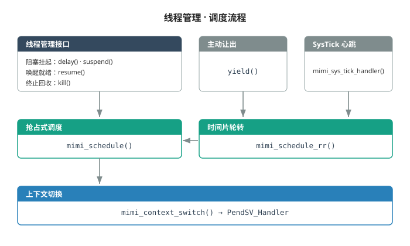
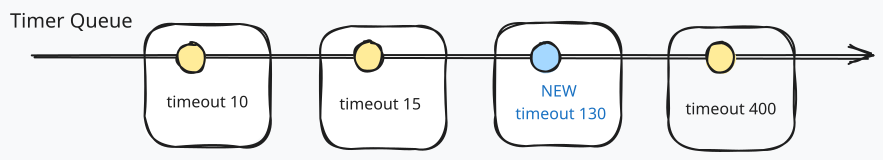
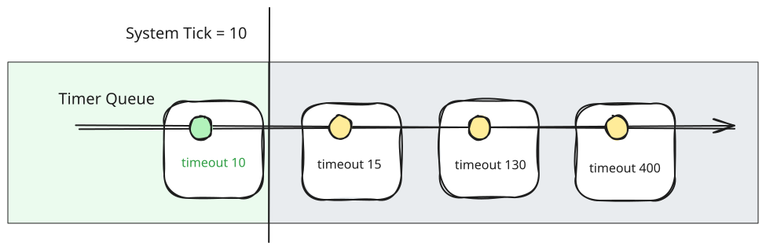
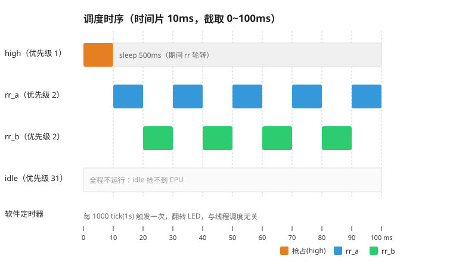

上一章[​线程切换](https://zhuanlan.zhihu.com/p/2095396229807190230)中，我们通过 PendSV 实现了两个线程的简单切换，但切换依赖线程主动让出 CPU。这一章我们将实现一个调度器，在全局的角度来管理线程。

代码新增了 `sched.c` 调度模块、`timer.c` 定时器模块、`log.c` 日志模块，以及单元测试：
```
code/
  ├── bsp/
  ├── kernel/
  │    ├── include/
  │    ├── src/
  │    │    ├── + timer.c
  │    │    ├── + sched.c
  │    │    └── + log.c
  │    └── utils/
  ├── ports/
  ├── app/
  ├── test/
  │    └── + test_mimi_timer.c
  └── platformio.ini
```
---

观察一个智能手表的日常使用场景，手机收到一条微信消息，手表同步振动提醒，用户抬起手腕，屏幕自动点亮，显示消息内容，然后点击预设消息完成回复。整个过程需要多个模块配合：蓝牙 BLE 收发和数据包解析，抬腕手势识别，触屏处理，GUI 渲染和刷新，以及多种外部中断。需要有一种合理的调度策略，处理 CPU 分配问题，既能满足实时性要求，也能达到 OS 并发的目的。

# 调度器
## 抢占式调度

单核 MCU 同一时刻只能有一个线程占用 CPU，不同模块的实时性要求不一样，容忍的最坏处理时间不同。手表收到手机传来的 BLE 数据，数据需要从 DMA 缓冲区及时取走，要求高实时性。后续蓝牙协议栈解析，将微信消息展示到 UI 上，这些环节对时延的容忍度变高，在合理时间范围内完成即可。

抬腕识别场景中，读取 IMU 数据需要较高实时性，否则关键数据可能被新数据刷掉。抬腕手势算法识别过程，即使被抢占，实际亮屏延后 100ms，也不会对用户体验影响太大。

抢占式调度，就是根据实时性，给不同的线程分配优先级，高优先级任务一来直接抢占低优先级线程，马上获取 CPU 使用权。mimiOS 支持 32 级优先级，编号越小优先级越高（0 最高），`ready_list[]` 记录不同优先级下可运行的线程。
```c
struct mimi_sched {
    uint32_t priority_mask;
    mimi_list ready_list[THREAD_PRIORITY_MAX];
} mimi_sched;
```
### 查找最高优先级

查找最高优先级，最简单的做法就是循环遍历 `ready_list[]`，最好的情况是 1 次循环，最坏是 32 次，不仅耗时，而且用时不确定。有没有方法可以优化呢？

在 Cortex-M3/4 上，我们可以使用汇编指令 RBIT 和 CLZ 的组合，配合一个 32 位整型变量，可以在 2 周期完成查找：

- `priority_mask`，32 位整型，按位记录优先级是否有就绪线程
- `RBIT`：把 32 位按位序完全翻转（最低位变最高位）
- `CLZ`：统计前导 0 的个数

举个例子：假设优先级 3 有就绪线程，`priority_mask = 0x0000_0008`，即 bit3 为 1。RBIT 把 bit3 翻到 bit28，CLZ 数出最高位到 bit28 之间有 3 个 0，得到最高优先级 3，两条指令，时间复杂度为 O(1)：
```
0x0000_0008  --RBIT-->  0x1000_0000  --CLZ-->  3
   bit3=1                bit28=1
```
mimiOS 使用 gcc 的封装 `__builtin_ctz()` 代替这两条汇编指令，CTZ 跟 CLZ 计数方向相反，等于 RBIT 加 CLZ 的组合：
```c
#define mimi_ctz(x)             __builtin_ctz(x)
```

## 时间片轮转

在一次任务链中，各个线程优先级关系很容易就可以确定，但是整个项目多个功能模块交错在一起，想要将所有线程都安排一个单独的优先级，在工程上很难完美实现，需求变更，以及维护成本直线上升。

对实时性要求不高的低优先级线程，可以安排到低档位优先级。这样就可能会出现一个优先级承载多个就绪线程的情况，多个线程保存在一个 FIFO 队列，没有干预的情况下，依赖线程主动阻塞让出 CPU 进行轮转，称为协作式轮转。

但如果某个同级线程从不阻塞（比如纯计算死循环），协作式轮转失效，该线程会一直霸占 CPU，其他同级线程会饿死。这时需要一个兜底策略，我们可以给每个线程设定一个时间片，耗尽就强制切换到下一个同级线程，这就是 RR（Round-Robin）轮转。

时间片以系统心跳为单位，通过系统定时器进行到期检查，一般不会设太小，避免频繁上下文切换带来性能损耗。 mimiOS 支持可配置的时间片，线程初始化的时候传入参数，默认是 10 ms。

**抢占式调度**和**时间片轮转**两种策略负责不同维度：优先级为纵向，保证实时性；轮转为横向，保证并发的能力。


## 调度入口

我们设计两个调度入口对应上面两个调度策略，`mimi_schedule()` 处理抢占式调度，`mimi_schedule_rr()` 处理 RR 调度。抢占的优先级高于轮转，所以我们都通过 `mimi_schedule()` 进行 PendSV 挂起操作。

PendSV 中断被设置为最低优先级，因此在挂起 PendSV 标志，到进入 PendSV 中断之间，可能会被其他高优先级中断抢占，再次触发调度。所以 `mimi_schedule()` 只做一件事情，如果最高优先级链表的头结点不是当前线程，则挂起 PendSV 进行上下文切换，操作优先级队列的行为都放在 `mimi_schedule()` 之外。
```c
void mimi_schedule(void)
{
    uint8_t prio = highest_priority();
    mimi_list *list = &mimi_sched.ready_list[prio];
    mimi_next_thread = container_of_tcb(mimi_list_head(list));

    if (mimi_next_thread == mimi_curr_thread) {
        return;
    }
    mimi_context_switch();
}

void mimi_schedule_rr(void)
{
    uint32_t level = mimi_enter_critical();
    mimi_tcb *thread = mimi_curr_thread;

    thread->remaining_tick = thread->tick_slice;
    mimi_list *list = &mimi_sched.ready_list[thread->priority];
    if (list->head == &thread->node) {
        mimi_list_rotate(list);
    }

    mimi_schedule();
    mimi_exit_critical(level);
}
```
## 空闲线程

如果所有线程都阻塞了，调度器找不到下一个线程，系统没法继续运行了，所以需要有一个空闲线程 Idle，优先级最低，永远就绪。

Idle 线程适合处理三类事务：

1. **资源整理**：耗时的操作延后处理，比如回收退出线程的资源，合并动态内存的碎片等。
2. **系统信息统计**：例如 CPU 使用率，Idle 线程运行的时间就是系统的空闲时间，CPU 占用率等于 1 减去空闲时间占比。
3. **低功耗入口**：Idle 运行时表示系统空闲，此时计算下一个定时器的到期时刻，进入低功耗睡眠，等待定时器超时中断或其他中断唤醒。

# 主流 RTOS 的调度策略

让我们看看主流 RTOS 的调度策略，纵向都是采用优先级抢占，差异主要在同优先级默认策略，是否默认开启时间片轮转：

| RTOS          | 同优先级默认策略 | 差异化                                              |
| ------------- | -------- | ------------------------------------------------ |
| mimiOS        | RR       | 每个线程独立配置时间片大小                                    |
| **FreeRTOS**  | RR       | 时间片默认 1 tick                                     |
| **RT-Thread** | RR       | 每个线程独立配置时间片大小                                    |
| **Zephyr**    | RR       | 协作优先级（负数）和抢占优先级（非负数），协作线程之间不能互相抢占                |
| **ThreadX**   | FIFO     | preemption-threshold 机制：只有优先级高于设定的阈值的线程，才能抢占当前线程 |
| **μC/OS-III** | FIFO     |                                                  |
| **VxWorks**   | FIFO     | 可以让单个任务退出轮转，时间片用完也不让位                            |
| **RTEMS**     | FIFO     | 支持 EDF + CBS 可插拔                                 |

# 线程管理

mimiOS 将线程简单分为三种状态：就绪态，挂起态和死亡态：

| 状态                  | 含义                         |
| ------------------- | -------------------------- |
| MIMI_THREAD_READY   | 线程初始化完成进入就绪态，挂载到优先级队列，等待调度 |
| MIMI_THREAD_SUSPEND | 线程睡眠，阻塞等待资源，不参与调度          |
| MIMI_THREAD_DEAD    | 线程死亡，脱离调度，释放资源             |
## 线程控制块

基于优先级和时间片轮转的调度策略，在线程控制块加上线程状态，错误码，优先级，时间片和软件定时器。
```c
typedef struct {
    mimi_node   node;

    void        *sp;
    uint32_t    stack_size;
    void        *entry;
    void        *param;
    char        name[THREAD_NAME_LEN];
    uint8_t     priority;

    mimi_err    error;
    mimi_thread_status status;

    uint32_t    tick_slice;
    uint32_t    remaining_tick;
    mimi_timer  timer;
} mimi_tcb;
```

## 线程主体

我们设计两种线程：一种是永不退出的线程，另一种是一次性或者有条件结束的线程。对于后者，我们可以配置一个退出后执行的钩子函数，线程首次运行时加载到其返回地址（即 lr 寄存器），进行自我了断。
```c
void thread_entry(void *param)
{
    while (1) {
        ...
        if (X) return;
    }
} // 退出后去到默认的退出钩子函数

void mimi_thread_exit_func(void)
{
    mimi_thread_kill(mimi_thread_current());
    // unreachable
}
```
## 线程状态切换

下面是 mimiOS 实现的管理线程的接口，核心逻辑都是操作挂载或者脱离优先级链表，然后触发一次调度。
```c
void mimi_thread_yield(void);
mimi_err mimi_thread_delay(uint32_t delay);
mimi_err mimi_thread_suspend(mimi_tcb *thread, uint32_t timeout);
mimi_err mimi_thread_resume(mimi_tcb *thread);
mimi_err mimi_thread_kill(mimi_tcb *thread);
```



# 系统定时器

我们需要一个系统定时器，完成两个核心功能：充当 RR 轮转的定时器，以及作为通用的软件定时器。Cortex-M 处理器内集成了一个小型定时器 SysTick，可以产生 SysTick 异常中断，作为系统心跳。所有的 Cortex-M 处理器都具有相同的 SysTick 定时器，所以 RTOS 一般使用该定时器作为系统定时器。

## 软件定时器

软件定时器能够完成低精度的定时操作，不需要额外占用硬件资源。跟线程队列一样，定时器也用侵入式链表串起来，复用同一套链表函数。定时方式分为单次和周期循环，周期定时器可以代替线程+Delay，周期完成轻量任务。
```c
typedef enum {
    MIMI_TIMER_RUNNING,
    MIMI_TIMER_STOP,
} mimi_timer_status;

typedef enum {
    MIMI_TIMER_ONCE,
    MIMI_TIMER_PERIODIC,
} mimi_timer_flag;

typedef struct _mimi_timer {
    mimi_node  node;

    uint32_t timeout;        // 相对超时值（周期）
    uint32_t stop_tick;      // 停止时的 tick（用于 resume）
    uint32_t timeout_tick;   // 绝对超时 tick
    mimi_timer_flag flag;

    timeout_handler handler; // 超时回调
} mimi_timer;
```

每个 tcb 都包含一个软件定时器，用在线程需要延时等待的操作上。例如线程阻塞等待信号量时，`tcb::node` 挂载信号量的等待队列，`tcb::timer::node` 挂载在软件定时器队列上，任意一方满足条件都可以反推出 tcb 唤醒线程。线程初始化时，给定时器带上默认的处理函数，用于唤醒线程：
```c
void mimi_thread_timeout_handler_default(mimi_timer *timer)
{
    mimi_tcb *thread = container_of_tcb_by_timer(timer);
    if (thread->status == MIMI_THREAD_SUSPEND) {
        thread->error = MIMI_ETIMEOUT;
        mimi_thread_resume(thread);
    }
}
```

软件定时器队列按超时时间点从小到大排序。插入时遍历队列，找到第一个比自己晚的定时器，插到它前面，如果遍历一圈都没找到更晚的，就直接 `push_back` 到队尾。超时检查时，一旦前面的定时器没有到期就可以退出，无论有多少定时器在等待，都能够把检查时间压缩到最短。




## SysTick 中断

前几章我们可以看到 `SysTick_Handler` 里会调用 `HAL_IncTick()`，给 `HAL_Delay` 提供时间基准。这一章我们开始接管 SysTick ，在中断里面完成两件事情：
1. 检查是否有定时器超时；
2. 消耗当前线程的时间片，检查是否需要切换线程；

mimiOS 软件定时器超时回调是在**SysTick 中断上下文**里执行的，回调里不能做耗时和阻塞等待的操作，应该通过 IPC（消息队列、信号量）把活转给线程去做。有的 RTOS 对是否在 中断里执行定时器超时函数有可配置项，例如 ThreadX。

> 注意：HAL_Delay 依赖 HAL_IncTick，SysTick 被 OS 接管后没有地方调 HAL_IncTick 了，HAL_Delay 就失效了，也用不上了。


## SysTick 初始化

SysTick 的初始化：注册 handler、加载计数值。`SysTick->CTRL` 没有设 `ENABLE_Msk`。使能推迟到 `mimi_context_first_switch` 首次启动时完成，保证 OS 初始化期间不会产生 SysTick 中断。
```c
mimi_err cortexm_systick_init(uint32_t ticksPerSec, void (*handler)(void))
{
    mimi_SysTick_Handler = handler;
    uint32_t ticks = SystemCoreClock / ticksPerSec;
    if ((ticks - 1UL) > SYSTICK_RELOAD_Msk) {
        return MIMI_ERROR;
    }
    SYSTICK_LOAD = (uint32_t)(ticks - 1UL);
    SYSTICK_VAL  = 0UL;
    SYSTICK_CTRL = SYSTICK_CLKSOURCE_Msk | SYSTICK_TICKINT_Msk;
    return MIMI_EOK;
}

void SysTick_Handler(void)
{
    mimi_SysTick_Handler();
}
```
# 验证

这一章用一个用例同时验证四件事：同级轮转、优先级抢占、软件定时器、空闲线程兜底。观察点只有板载 LED 和串口。



| 机制    | 线程          | 优先级 | 行为                 | 预期           |
| ----- | ----------- | --- | ------------------ | ------------ |
| 时间片轮转 | rr_a / rr_b | 2   | 忙等，不 sleep 不 yield | 两者每秒计数接近     |
| 抢占    | preempt     | 1   | 每 1s 醒来打印再睡        | 打印稳定插在 rr 之间 |
| 软件定时器 | heart_timer | 无   | 周期 1000 tick 翻 LED | LED 每秒闪一次    |
| 空闲线程  | idle        | 31  | 内核自建，永不阻塞          | 全睡时接管        |

关键只有两处：rr 和 preempt 的优先级差，以及定时器启动。完整代码见 `code/app/app.c`。

```c
mimi_thread_init(&preempt_thread, "preempt", 1, 0, ...);         // prio 1：比 rr 高
mimi_thread_init(&rr_a_thread, "rr_a", 2, 0, ...);         // prio 2
mimi_thread_init(&rr_b_thread, "rr_b", 2, 0, ...);         // prio 2，与 rr_a 同级
mimi_timer_start(&heart_timer, 1000, MIMI_TIMER_PERIODIC); // 1s 周期翻 LED
```

预期现象：

- **轮转**：`[rr_a]`、`[rr_b]` 每秒各打印一次，`xxx/s` 数值接近。如果不轮转，一个线程霸占 CPU，另一个会饿死、数值趋近 0。
- **抢占**：`[preempt] wake N` 每 1s 一条，稳定插在 rr 两组输出之间。
- **定时器**：LED 每秒翻转，节奏和串口无关。
- **空闲**：把 rr_a/rr_b 的入口临时换成 `mimi_thread_delay(10000)`，所有业务线程阻塞后系统仍稳定，就是 idle 在兜底。

---

# 下一步

这一章我们实现了带优先级的抢占式调度和时间片轮转，以及配套的软件定时器。下一章我们将完成线程同步和通信机制，实现线程与线程之间的配合。

→ [同步与通信](../4_ipc/同步与通信.md)
