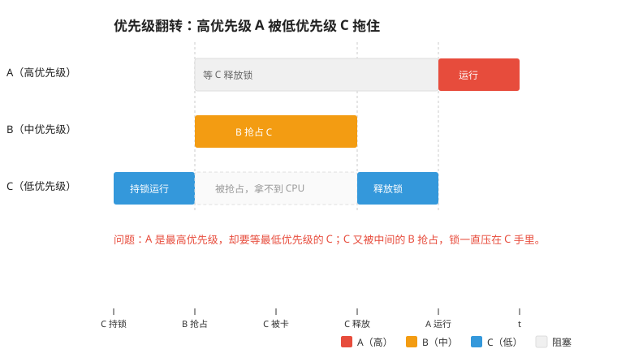
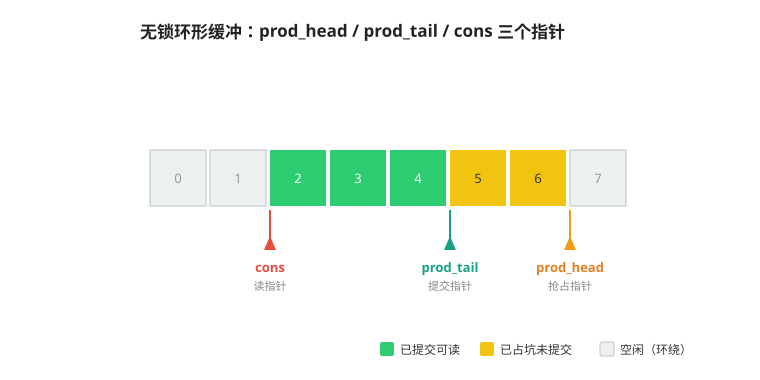

上一章[线程管理和调度](../3_scheduler/线程管理和调度.md)中，mimiOS 实现了基于优先级抢占和时间片轮转的调度器，这一章需要解决的是线程之间，以及线程和中断之间的配合。

代码新增了 `ipc.c`（信号量、互斥锁、消息队列）、`ringbuffer.c`（无锁环形缓冲），`log.c` 从同步日志改成了异步日志，并补了对应的单元测试：
```
code/
  ├── bsp/
  ├── kernel/
  │    ├── include/
  │    │    └── + ipc.h
  │    ├── src/
  │    │    ├── + ipc.c
  │    │    └── ~ log.c
  │    └── utils/
  │         ├── + ringbuffer.h
  │         └── + ringbuffer.c
  ├── ports/
  ├── - app/
  ├── + examples/
  ├── + services/
  ├── + test/
  └── platformio.ini
```

---

# 线程同步

线程同步主要处理下面两种情况：

1. 线程需要等待资源就绪，才能进行后续任务，例如线程获取 socket 资源，可以使用信号量表示可用数量；
2. 避免多个线程同时使用共享资源，例如两个线程共用同一条 I2C 总线，需要防止被抢占导致时序混乱，即使是更高优先级线程也不可以抢占，需要互斥锁来保护共享资源。

## 信号量

信号量是一个带上限的计数器，用来表示某个资源可用数量，或者当成二元信号量，表示某个事件是否发生。最大的作用是能阻塞和唤醒线程，构成准确的异步链条：

- take（P 操作）：计数减一，减到 0 之后，线程阻塞等待。
- release（V 操作）：计数加一，如果等待队列非空，唤醒队首的线程。

### 获取信号量

获取信号量的行为分为两种情况：
1. 信号量大于零，成功获取；
2. 信号量等于零，根据同步语义，我们可以设定一个超时时间，让线程进入阻塞等待；

我们得到了信号量的结构体定义：
```c
typedef struct {
    uint32_t  max_cnt;       // 计数上限
    uint32_t  cnt;           // 当前计数
    mimi_list suspend_list;
} mimi_sem;
```

重点在超时等待和阻塞恢复。超时等待通过系统软件定时器完成，超时则唤醒线程，返回失败。阻塞等待然后成功获取信号量的路径，通过释放信号量的函数完成。mimiOS 信号量阻塞队列设计为按照优先级排列，也是抢占调度的一种体现。

### 释放信号量

`release` 函数首先判断等待队列是否为空，非空则弹出队首的线程并唤醒它。如果没有阻塞的线程，再增加计数器，这样能够减少计数修改，防止引入 bug；

### 中断通知线程

信号量最常见的用法，是中断通知线程。中断里避免做耗时操作，把中断的下半部分交给线程处理。中断里调用 `release` 是安全的，它不阻塞，只计数和唤醒。线程里调用 `take` 才可能阻塞，这正合适：等待发生在线程里，中断保持简短。

```c
mimi_sem rx_sem;

// 串口接收中断
void UART_Rx_ISR(void)
{
    mimi_sem_release(&rx_sem);    // 通知有数据了
}

// 处理线程
void uart_proc_entry(void *param)
{
    while (1) {
        mimi_sem_take(&rx_sem, MIMI_TIMEOUT_FOREVER);   // 等数据
        // 处理收到的数据
    }
}
```

## 互斥锁

信号量用来同步等待资源，互斥锁用来保护共享资源，进行独占访问。

### 保护共享数据

举个例子。`shared_cnt++` 这行代码，编译后是读变量、加一、写回三条指令。程序运行时线程可能在任意位置切换，在读变量后被切走，切回来已经是一个旧的变量了，两个线程各加 10000 次，结果可能不是 20000。互斥锁把 `shared_cnt++` 变成原子操作，同一时刻只有一个线程能进入临界区。
```c
void worker_entry(void *param)
{
    for (int i = 0; i < 10000; i++) {
        mimi_mutex_lock(&mtx, MIMI_TIMEOUT_FOREVER);
        shared_cnt++;
        mimi_mutex_unlock(&mtx);
    }
}
```
一般情况下，互斥锁的获取释放逻辑跟二值信号量一致。为了防止一个线程多次获取同一把锁导致死锁，我们增加一个嵌套支持，这样我们得到了互斥锁的结构体定义：
```c
typedef struct {
    uint8_t       lock_nest;     // 嵌套计数
    mimi_tcb      *owner;        // 持有线程
    mimi_list     suspend_list;  // 阻塞等待队列
} mimi_mutex;
```
1. `owner` 记录持有线程，用于锁嵌套，同时校验解锁时是否同一线程的动作；
2. `lock_nest` 嵌套计数，mimiOS 的互斥锁支持同一线程嵌套上锁，最后一次解锁才是真正对外解锁。

### 优先级翻转

先来看一个例子：有三个线程，优先级从高到低是 A、B、C。

1. C 先获取锁，进入临界区。
2. A 也请求这把锁，因为锁被占用，只能阻塞等 C 释放。
3. 这时 B 就绪。B 优先级高于 C，抢占 C 的 CPU。
4. C 拿不到 CPU，无法释放锁，A 只能继续等。

结果是最高的 A 等最低的 C，中间又被 B 卡住。A 的有效优先级被拉低到 C 的水平，这就是优先级翻转问题。




有个著名的例子：1997 年，搭载着 VxWorks 的火星探路者着陆后反复重启，查了很久才发现，一个低优先级的气象任务持有了高优先级任务需要的锁，被中优先级的通信任务持续抢占，导致高优先级任务超时，触发看门狗重启。

我们可以通过**优先级继承**机制规避这个问题，A 请求锁的时候，将 C 的优先级提升到 A 的级别，当一会人上人，防止被 B 抢占，C 释放锁的时候再恢复其原有的优先级。需要注意的是，一个线程可能会持有多个锁，真正恢复优先级需要等到所有锁都释放，防止直接恢复到低优先级又导致优先级翻转。所以 `mimi_tcb` 中增加了变量 `mtx_hold`，用于记录线程持有锁的数量。

# 线程通信

mimiOS 实现两种通信机制：消息队列传输固定长度的消息，无锁 RingBuffer 传输不定长的字节流。

## 消息队列

通过消息队列，我们可以将数据采集和处理分为两个线程，分别赋予不同优先级，两个线程能够解耦开来，独立实现。

首先来定义消息队列的数据结构，mimiOS 的消息队列设计为每条消息长度固定，数据缓冲区被划分成 `capacity` 个槽，每个槽放一条消息，本质上是一个数组结构的环形缓冲区。

我们还需要指向数据读写位置的索引，`prod` 指向下一个空槽，新消息从这里入队；`cons` 指向下一个待读槽，消息从这里出队。两个指针只在 `buffer` 和 `end` 划定的范围内移动，走到 `end` 就回到 `buffer`，构成一个环形。

类似线程同步，最后加上接收等待队列，我们得到了消息队列的结构体定义：
```c
typedef struct {
    uint32_t msg_size;             // 每条消息长度（字）
    uint32_t capacity;             // 槽位数量
    uint32_t cnt;                  // 当前消息数

    unsigned long *prod;           // 写指针，指向下一个空槽
    unsigned long *cons;           // 读指针，指向下一个待读槽
    unsigned long *buffer;         // 缓冲区起点
    unsigned long *end;            // 缓冲区终点

    mimi_list recv_suspend_list;   // 等待消息的线程队列
} mimi_mqueue;
```
### 发送消息

我们根据缓冲区和接收队列的情况分类讨论：

1. 先看接收等待队列，如果非空，我们可以直接将消息拷贝到等待线程的 buffer，不经过队列，减少一次中转损耗。mimiOS 将等待线程的 buffer 记录到 `TCB->mq_buffer`，阻塞等待前赋值到该变量上；
2. 等待队列是空的，缓冲区未满，将数据拷贝到缓冲区，然后推进 prod 指针。

如果缓冲区已满，不得不丢掉一些数据，该丢掉哪一份呢？我们可以通过 flag 控制

- `MIMI_MQ_FULL_DROP` 丢弃本次数据，返回发送失败；
- `MIMI_MQ_FULL_OVERWRITE` 覆盖最旧的一条消息；
- `MIMI_MQ_URGENT` 紧急消息插队，接收者会先取到它。队列没有满时，数据写到队头的前一格，读指针后退一格；队列已满时，则覆盖最旧的一条消息。

### 消息拷贝

对消息队列性能影响最大的是数据拷贝，拷贝方式直接决定队列的吞吐。

最直接的思路是按字拷贝，一次搬运填满一个寄存器，Cortex-M 是 32 位机，寄存器一次能搬 4 个字节，相比普通的 memcpy 逐字节拷贝，能够有效减少循环次数：
```c
mimi_inline void mq_copy_words(void *dst, const void *src, uint32_t words)
{
    uint32_t *d = (uint32_t *)dst;
    const uint32_t *s = (const uint32_t *)src;

    while (words--) {
        *d++ = *s++;
    }
}
```
 除此之外，我们还可以利用 gcc 提供的内建函数 `__builtin_memcpy`，当长度为常量并且不大时，编译器能直接把拷贝展开成 ldm 和 stm，利用多寄存器，最大限度优化运行周期。

### 接收消息

接收消息的行为分两种情况处理：

1. 队列里有消息：接收函数从 `cons` 槽复制出数据，`cons` 前移，`cnt` 减一，立即返回；
2. 队列为空：按超时参数处理：参数指定不等待，就返回错误；否则线程阻塞进入等待队列。

线程阻塞之前要做两件准备工作。接收函数先把接收缓冲挂到 `mq_buffer` 字段，这是留给发送方直达复制的位置；再把线程挂到 `recv_suspend_list`，同时装上超时定时器，最后让出 CPU，阻塞和唤醒的机制跟信号量的一样。


## 无锁队列

mimiOS 的消息队列按条处理，消息长度固定，遇上 log 模块，单条日志长度从几个字节到几百个字节不定，还可能同时来自好几个线程甚至中断。所以我们需要新的方式能够储存字节流，并且支持中断和线程“同时”占用写入端。

### 原理

mimiOS 的 `ringbuffer.c` 是一个多生产者单消费者（MPSC）的无锁环形缓冲区，思路参考 DPDK 的 ring buffer，依赖一个叫 CAS 的原语。

CAS（compare-and-swap）把比较和交换封装成一次原子操作，用法是 `CAS(ptr, old, new)`。`ptr` 是目标地址，`old` 是这个地址不久前的值，`new` 是准备写入的新值。处理器执行 CAS 时，先比较 `ptr` 当前的值是否还等于 `old`，相等就把 `new` 写进去，比较和写入一次完成，中间不会插入其他执行流；不相等就写入失败，调用重试一次在尝试。

在 Cortex-M 上，这个内建函数展开为 ldrex 和 strex 指令对。ldrex 标记一段独占访问，strex 只有在这段独占没有被破坏时才会成功，两个指令之间来了别的写操作，strex 就失败重来。宏观上没有锁，微观上是 CPU 的一条极小的硬件保证，无锁这个名字就是这么来的。
```c
typedef struct {
    volatile uint32_t prod_head;   // 生产者抢占的写位置
    volatile uint32_t prod_tail;   // 生产者提交的写位置
    volatile uint32_t cons;        // 读位置，只有消费者写
    uint32_t          capacity;    // 容量，必须是 2 的幂
    uint8_t           buffer[];    // 柔性数组，调用方分配
} mimi_ringbuffer;
```

三个指针各管一段边界，都是单调递增的位置，通过位与映射到物理地址，可以避免频繁求余带来的性能损耗：

- `prod_head`：生产者抢到的最远写位置，多个生产者用 CAS 竞争推进它；
- `prod_tail`：已经写完、可以读的位置，消费者只读到 `prod_tail` 为止；
- `cons`：消费者读到的位置，只有消费者修改它，不需要原子操作。



### 无锁的意义

无锁队列最大的价值，是中断里也能安全地写。线程写队列要先上锁，上锁期间中断再进来写就会失败，由于中断不能阻塞，数据相当于丢掉了。使用无锁队列，中断的数据正常写入，线程一侧 CAS 失败，重新申请写入位置即可，两边的数据都正常入队。

同样的竞争在多核场景更常见，两个核心上的线程会同时写同一个 ringbuffer。加锁的方案要面对三个问题：自旋锁把所有访问串行化，等待者空转 CPU；锁的持有者可能跑在另一个核上，优先级继承这类单核手段失效；锁本身也要靠原子操作实现，临界区越长风险越大。无锁队列把同步竞争缩小到一次 CAS，尽可能减少冲突范围。

### 消息入队

第一步：CAS 成功的生产者拿到 `[old_head, new_head)` 这一段内存的独占写入权，其他生产者 CAS 失败，重新读取 `prod_head` 再试。空间检查以 `prod_head` 为准，已申请未提交的位置也算作已用，保证两个生产者不会申请到重叠的区域。

```c
static mimi_err update_prod_head(mimi_ringbuffer *ring, uint32_t len,
                                 uint32_t *old_pos)
{
    uint32_t old_head;
    uint32_t new_head;

    do {
        old_head = ring->prod_head;
        if (get_space(ring) < len) {
            return MIMI_ERROR;
        }
        new_head = rb_pack(rb_pos(old_head) + len, rb_cnt(old_head) + 1);

    } while (!CAS(&ring->prod_head, old_head, new_head));

    *old_pos = rb_pos(old_head);
    return MIMI_EOK;
}
```

第二步：往自己独占的内存写入数据，数据写到缓冲区尾部就绕回头部，分两段复制完成。

第三步：推进 `prod_tail`。这时候可能会遇到问题：线程 A 申请写入区域 `[1,10]` 后，ISR 抢占 CPU，申请后续的区域 `[11,20]` 并完成写入，回到线程 A 后继续完成写入，`prod_head` 为 20，而 `prod_tail` 会先被 `ISR` 更新为 20，再被线程 A 更新为 10，导致数据错乱。

为了解决这个问题，我们可以给 `prod_tail` 和 `prod_head` 都增加一个计数，head 的计数是申请序号，tail 的计数是提交序号，计数相等才代表所有数据写入完成，正式推进 `prod_tail`，开放给消费者。相同的问题就可以解决：
1. 线程 A 申请写入区域 `[1,10]` 后，`prod_head = pack(10, cnt:1)`；
2. ISR 申请写入区域 `[11,20]` 后，`prod_head = pack(20, cnt:2)` ；
3. ISR 写入完成后 `prod_tail = pack(0, cnt:1)`，实际位置不变；
4. 回到线程 A 写入完成后，计数等于 `prod_head` 的计数，`prod_tail = pack(20, cnt:2)`，`cons` 才能继续推进。

Cortex-M 的 ldrex/strex 最多支持 32 位的独占内存访问，无法同时原子更新位置和计数两个字段，若将“位置索引”与“计数”分离为独立变量，会面临并发冲突。所以我们将二值打包进 32 位的变量，拆为位置索引（低 24 位）和计数（高 8 位）两部分。
```c
static void update_prod_tail(mimi_ringbuffer *ring)
{
    while (1) {
        uint32_t old_tail = ring->prod_tail;
        uint32_t current_head = ring->prod_head;
        uint32_t new_count = (rb_cnt(old_tail) + 1) & MIMI_RB_CNT_MASK;
        uint32_t new_tail  = rb_pack(rb_pos(old_tail), new_count);

        if (new_count == rb_cnt(current_head)) {
		    /* 计数相等才推进 pos */
            new_tail = rb_pack(rb_pos(current_head), new_count);
        }

        if (CAS(&ring->prod_tail, old_tail, new_tail)) {
            return;
        }
    }
}
```

### 消息出队

1. 首先通过 `rb_pos(prod_tail) - cons` 算出可读的数据量。
2. 显式执行一次内存屏障，保证后面读取缓冲区内容的动作不会被排到读取 `prod_tail` 之前。否则消费者可能拿着新的 `prod_tail`，却读到生产者还没写完的旧字节。
3. 从 `cons` 开始拷贝，数据跨过缓冲区尾则分两段拷贝。
4. 最后把 `cons` 前移，因为只有一个消费者，不需要原子操作。


# IPC 实际应用

现在我们有了多种 IPC 模块，可以搞点更复杂的东西玩了。mimiOS 在这章实现了异步 log 模块和一个简单的控制台：

## 异步 log 模块

第三章的日志是同步的，`printf()` 直接输出到串口，而项目用到的 newlib 中，`printf()` 是不可重入的，而且串口发送是慢操作，整个线程阻塞在串口发送上，等发送完成才能继续。我们把日志打印改成异步：

log 打印接口在当前线程完成字符串格式化，写入无锁队列，然后触发信号量；
```c
void mimi_log_printf(char level, const char *fmt, ...)
{
    char print_buffer[LOG_TEMP_BUFFER_SIZE];
    // 拼上时间戳、级别、线程名
    ...
    if (mimi_ringbuffer_write(&log_ringbuffer.ring, print_buffer, len) == MIMI_EOK) {
        mimi_sem_release(&log_sem);   // 通知日志线程有活了
    }
}
```

日志线程阻塞在信号量上，被唤醒后把队列里的字节全部输出到串口：
```c
void mimi_log_thread_entry(void *param)
{
    while (1) {
        mimi_sem_take(&log_sem, MIMI_TIMEOUT_FOREVER);
        while ((len = mimi_ringbuffer_read(&log_ringbuffer.ring,
                read_buffer, LOG_TEMP_BUFFER_SIZE)) > 0) {
            mimi_log_output_func(read_buffer, len);
        }
    }
}
```
信号量和无锁队列各司其职：二值信号量表示有日志到达，唤醒日志线程；无锁队列保存日志字节。写日志的调用方可能是任何线程甚至中断，只做两件事：写 ringbuffer、release。真正访问串口的只有日志线程，速度慢的串口输出被隔离在这个线程里，不影响其他线程。

## 简易控制台

加入的模块变得很多了，很难通过单个按钮完整演示，我们来做一个简易的控制台，输入不同测试指令完成用例演示。指令注册沿用了自动初始化的思路，把指令及处理函数地址放到 `.mimi_cmd_fn` 段。
```c
#define MIMI_CMD_EXPORT(cmd, fn)                                    \
    const char __mimi_cmd_##cmd[] = #cmd;                           \
    mimi_used const struct mimi_cmd_desc __mimi_cmd_desc_##fn       \
        mimi_section(".mimi_cmd_fn") = { __mimi_cmd_##cmd, fn};
```

测试函数下面写上 `MIMI_CMD_EXPORT`，串口收到一条指令，交给控制台线程，匹配注册的指令，执行对应函数。
```c
int sem_test(void) { ... }
MIMI_CMD_EXPORT(semtest, sem_test);

int mimi_console_input(const char* cmd, int len)
{
    mimi_cmd_for_each {
        if (len == strlen(desc->cmd) &&
            strncmp((const char*)cmd, desc->cmd, len) == 0) {
            return desc->fn();
        }
    }
    MIMI_LOG_I("undefine command\r\n");
    return MIMI_EOK;
}
```

# 基础用例演示

这一章加入了不同的 IPC 模块，每个模块又有自己的特殊点，在 examples 文件夹，mimiOS 准备了详尽的测试用例，通过串口输入测试指令触发。

- 信号量：2 个消费者 + 1 个生产者；
- 互斥锁：加解锁、优先级继承；
- 消息队列：收发、发送满丢包，发送满覆盖。

代码烧录后，观察打印或者往串口输入 cmd，就会列出所有注册的指令。

# 下一步

这一章我们完成了线程之间的同步与通信，mimiOS 内核基本完善，下一章我们进行性能测试，跟其他 RTOS 比一比。

→ [性能测试](../5_benchmark/性能测试.md)
