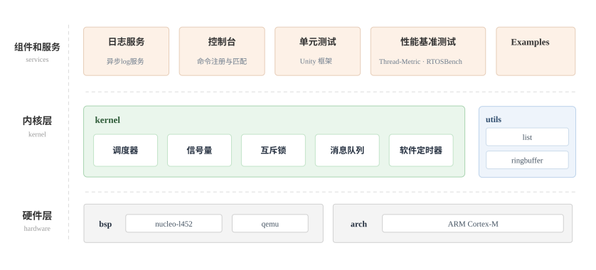

本教程将一步一步地介绍如何从头开始实现一个轻量的 RTOS 内核，完成最基本的功能：**线程管理和调度**，**线程间同步与通信**。项目选用 STM32 Nucleo-L452 开发板作为硬件载体，也可以替换为其他的 Cortex-M 芯片的开发板。

为什么要起名为 mimiOS 呢，因为我养了两只英国小猫咪 ~

# 目录

- [了解 Cortex-M](了解%20Cortex-M.md)：补充一下 Cortex-M 的相关知识
- [搭建开发环境](搭建开发环境.md)：跑通 CubeMX + PlatformIO，输出 Hello world
- [启动第一个线程](1_first_thread/启动第一个线程.md)：了解 RTOS 启动流程，通过异常切换到线程
- [线程切换](2_thread_switch/线程切换.md)：通过 PendSV 完成上下文切换，构建自动初始化
- [线程管理和调度](3_scheduler/线程管理和调度.md)：优先级抢占、时间片轮转、软件定时器
- [同步与通信](4_ipc/同步与通信.md)：信号量、互斥锁、消息队列、无锁 ringbuffer
- [性能测试](5_benchmark/性能测试.md)：Thread-Metric 与 RTOSBench 两套基准，测量能力带宽和

# 运行

本项目开发环境为 VSCode + PlatformIO，能够快速上手，并且有更现代化的开发体验，详细请看 [搭建开发环境](搭建开发环境.md) 。每章 code 目录都是**一个 PlatformIO 工程**，能够单独编译烧录。

# 性能测试

**Thread-Metric-Benchmark** 套件：结果为单位时间的执行次数，反映性能带宽。还有更多的单一功能路径耗时测试，详细请看 [性能测试](5_benchmark/性能测试.md) 一节。

| 测试项                    | FreeRTOS 10.3.1 | ThreadX 6.2 | mimiOS      |
| ---------------------- | --------------- | ----------- | ----------- |
| Basic Processing       | 32479           | 32466       | 32478       |
| Cooperative Scheduling | 2976089         | 2957402     | **3301383** |
| Preemptive Scheduling  | 710736          | 1142987     | **1181168** |
| Message Processing     | 913801          | **2006418** | 1920190     |
| Sync Processing        | 1751598         | 3501924     | **3803479** |

---

# 参考资料

架构相关：
- [ARM Cortex-M3与Cortex-M4权威指南 第三版](https://github.com/TangxzYiLin/book-1/blob/master/book/embedded/ARM%20Cortex-M3%E4%B8%8ECortex-M4%E6%9D%83%E5%A8%81%E6%8C%87%E5%8D%97.big.pdf)
- [Cortex+M3权威指南(中文).pdf](doc/Cortex+M3权威指南(中文).pdf)
- [Armv7-M Architecture Reference Manual](doc/DDI0403E_e_armv7m_arm.pdf)

芯片与开发板：
- [stm32L4xx参考手册](doc/stm32L4xx参考手册.pdf)
- [stm32l452数据手册](doc/stm32l452数据手册.pdf)
- [Nucleo-L452RE用户手册](doc/Nucleo-L452RE用户手册(UM1724).pdf)
